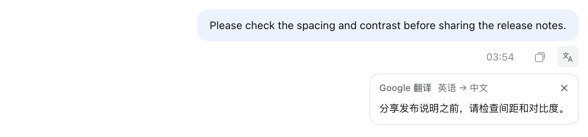
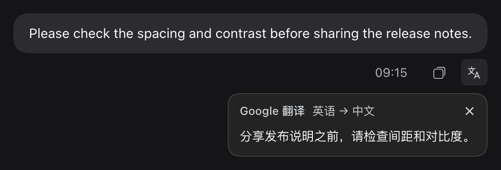

# dsh-message-translate

[简体中文](README.zh.md)

Adds a Translate button to finalized text messages; clicking sends that message's text from the browser
to `translate.googleapis.com` and displays the result in a card below it.

- Hover an earlier message (or check the action row under the latest reply) and click the translate icon
  to translate into the current DSH interface language; click the close button to dismiss.
- Nothing leaves the machine before you click.
  Results render as plain text (code blocks are translated verbatim and Markdown is not re-rendered),
  and messages already in the interface language show an "Already in …" notice.

Requires DeepSeek Harness `0.2.2-rc.5` or newer.
Enable **Message translation** in **Session Modular Improvement Plan**, or run `pnpm install` in this directory
and select it in **Plugins → Add plugin** (or via `install_bundle`).

## Screenshots

The card below the English message shows its Chinese translation (Chinese UI).

| | Light | Dark |
| --- | --- | --- |
| Translation card |  |  |

[Project documentation](docs/README.md)
