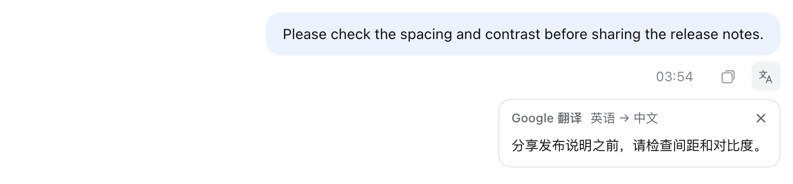
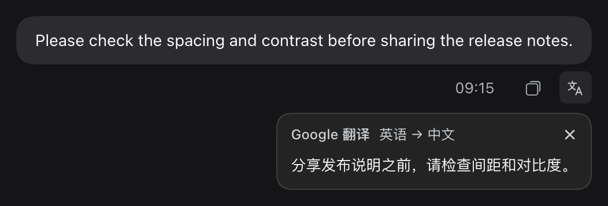

# dsh-message-translate

[English](README.md)

在已定型的纯文本/富文本消息下方添加翻译按钮；
点击后直接从浏览器请求 `translate.googleapis.com` 并把译文卡片显示在原消息下方。

- 悬停历史消息或在最新回答下方操作行点击翻译图标，即可翻译为当前 DSH 界面语言；点击卡片关闭按钮收起。
- 点击前不会发送任何内容；译文按纯文本显示（代码块按普通文字处理，Markdown 不重新排版），
  与界面语言一致时提示「已经是…」。

需要 DeepSeek Harness `0.2.2-rc.5` 或更新版本。可在 **会话模块化改良计划** 中直接开启 **消息翻译**，
或在源码目录运行 `pnpm install` 后从 **插件 → 添加插件** 选择本目录（或用 `install_bundle` 安装）。

## 实拍截图

译文卡片位于英文原消息下方，标出检测到的语言与翻译方向。

| | 浅色 | 深色 |
| --- | --- | --- |
| 翻译卡片 |  |  |

[项目文档](docs/README.md)
