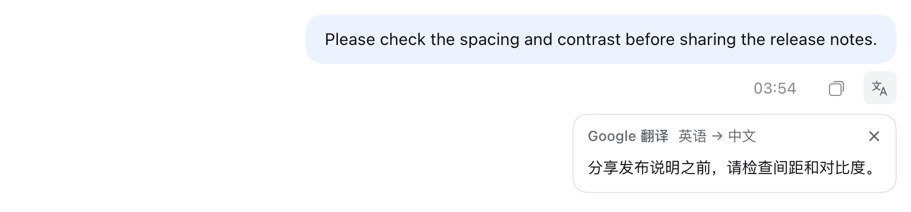

把鼠标移到较早的消息上，或查看最新回答下方的操作行，点击翻译图标。
消息下方的卡片会显示检测到的语言和译文，点关闭按钮收起。

按钮只出现在已定型且包含文字的消息上。
流式回复在完成后获得按钮。

翻译在浏览器里直接请求 `translate.googleapis.com`；点击后该条消息的文字会发往 Google，点击之前不会发送内容。
译文按纯文本显示，Markdown 语法保持字面形式。

[安装与限制](https://github.com/miorin-chan/dsh-message-translate#readme)
